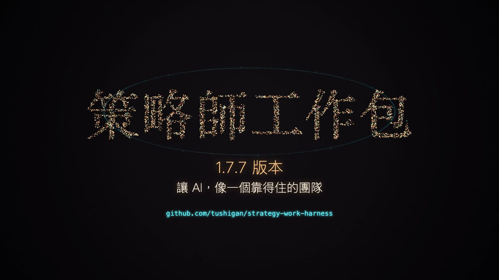

# 策略师工作包（Codex / Claude Code 统一包）

**当前版本：v1.7.6 ｜ 发布日期：2026-10-14 ｜ 仅 Mac**

给策略咨询项目用的本地工作包：一个客户项目一个文件夹，里面带规则（`AGENTS.md`）、15 个业务技能、6 个工作角色和登记 / 版本 / 独立检核 / 交接的程序。Codex 和 Claude Code 共用同一个文件夹，可以交替续做。它不是网页系统，不需要服务器、账号或密钥；空白包不含任何客户资料。

## 一分钟看懂

[](宣传短片/strategist-harness-promo.mp4)

点上图观看 65 秒宣传短片（繁体字幕、台湾腔配音）：没有工作包时 AI 会忘东忘西、搞混版本、自己检查自己、换工具就从零开始；装上之后一个项目一个文件夹，说一句话就接着做。

## 安装或更新：复制下面一段给你的 Agent

```text
请从 https://github.com/tushigan/strategy-work-harness 安装或更新“策略师工作包”。
先读取仓库根目录的《给Agent的安装更新提示词.md》和《版本清单.json》，再按其中流程执行。
我要装到的目录：【新项目写目录路径；已有项目写现有工作区路径】
没有安装就安装最新发布版；已有工作区先备份再更新，project/ 里的业务资料一个文件都不能改、删、移；已是最新版且文件完整就不重复覆盖。
下载后按发行清单逐文件核验哈希，装完再跑一遍包内检查并把实际输出给我。
不要安装付费或需要账号的东西；缺什么环境如实列出。没有网络或读不到本地文件请直说，不要声称完成。
完成后告诉我：当前版本、工作区路径、检查结果、还要我决定什么。
```

首次安装和以后更新用同一段。以后仓库发了新版本，再贴一次，Agent 会比对版本清单，只替换工作包文件，不碰项目资料。详细流程见[给 Agent 的安装更新提示词](给Agent的安装更新提示词.md)。

## 仓库里有什么

```text
README.md                     本页
给Agent的安装更新提示词.md     Agent 安装 / 更新的完整流程
版本清单.json                  当前版本、发布包哈希、升级规则、历史版本
策略师工作包/                  工作包本体（复制这一个目录到你的项目位置并改名）
```

发布页（Releases）另附同内容的 ZIP 与 SHA-256，供离线安装。工作包本体里每个文件的哈希在 `策略师工作包/package-inventory.json`，`scripts/package_audit.py audit` 会逐文件核对。

## 装好以后怎么用

1. 用 Codex 或 Claude Code 打开项目文件夹，说：“检查工作包环境和项目进度，告诉我缺什么资料。”
2. 之后直接交任务、资料、反馈和确认。登记、版本、检核、交接由 Agent 运行程序完成，不需要你写命令。
3. 换工具前让当前助手先保存成果与交接，另一边打开同一文件夹说：“读取项目交接和当前任务记录，继续工作。”同一项目不要两个主会话同时写。

包内说明按工作查：[工作能力与流程总览](策略师工作包/工作能力与流程总览.md) · [运行环境与命令](策略师工作包/运行环境与命令.md) · [策略与品牌屋](策略师工作包/策略与品牌屋运行说明.md) · [提案与设计检核](策略师工作包/提案与设计检核运行说明.md) · [项目检核与结项](策略师工作包/项目检核与结项运行说明.md) · [工作包移交](策略师工作包/工作包移交说明.md) · 规则全文 [AGENTS.md](策略师工作包/AGENTS.md)。

## 环境

- 必需：macOS、Python 3.11+。
- 可选：本机 Google Chrome + Playwright（演示稿视觉增量检核、对外导出；用 `HARNESS_NODE_MODULES` 指向含 playwright 的 `node_modules`，不设则视觉检核一律全页）；`pypdfium2`（PDF 逐页比对）；`@oai/artifact-tool`（合同排期导出 Excel）。
- 飞书、云端大脑等外部连接需要各自账号与授权，安装本包不等于已连通。

## v1.7 做了什么

- **只看变化页**（v1.7.0）：演示稿 HTML / PDF 新版与上一份通过检核的版本逐页按像素比对，没变的页沿用上次结论；HTML 与 PDF 是否同一版由程序比文字。
- **成品只留最新 2 版**（v1.7.0）：更早的版本自动移到同级 `<项目目录名>-归档/`，只移不删，已发客户和当前检核基线的版本不移。
- **v1.7.1**：修渲染卡住。**v1.7.2**：修在途项目升级时发现的 4 项缺陷（成果目录里读不了的 JSON 不再阻断整个工作区；版本保留不移例外版共用的文件、试算与实际一致、含记录的旧版不再整版跳过）。
- **v1.7.3**：修在途项目升级后发现的 4 项缺陷（已结束的分派输入文件后来变了不再阻断工作区；项目记忆等追加式记录追加后旧引用不再失效；resume 显示“有效独立检核”与发客户时的检核口径一致；工作区 blocked 时反复 resume 不再被重试守卫拦下）。
- **v1.7.4**：修在途项目使用中发现的 1 项缺陷（检核派出后又追加了项目记忆时，检核报告登记、再派检核、增量检核、接受新记忆、在线改稿与进度更新不再互相卡住；检核员按报告模板列登记时的指纹；交付物仍按整文件核对）。
- **v1.7.5**：按在途项目使用中发现的问题迭代——
  - **对策略师说人话**：回复和策略师要读的文件固定三段（发生了什么、对你有什么影响、要你做什么），程序用语和英文字段放进给 Agent 看的附录；附带扫描与词表。
  - **凭据不落地**：资料里像密钥、令牌的文件和字符串，在记一笔、启动检查、发行检查三处用同一个判定挡住。
  - **报错看得懂**：运行日志存一行去掉敏感信息的报错首行；登记被拒时点名是哪个字段；看进度时的提醒按类归并，一屏能读完。
  - **先交后检**：交给策略师的版本当场记一笔并附一行状态；检核可以在背后跑，有问题主动提醒；带策略师原话的改稿轮次不受两轮上限。
  - **发客户记账**：支持先发出后补登记（两个时间都记）；不检核的原因分三种来源；策略师说“这是最终版”而那一版没有检查通过时，只摆一行事实，她说不用查就不再出现。
  - **事实台账**：关键说法一行一条，改了自动列出受影响的页；检核时改过说法的页必看。
  - **体积与导出**：对外导出也按版本只留最新几版（只移不删）；导出前预检会被 PDF 写坏的字；PPT 与网页版逐页核对文字。
  - **接口变化**：取消派工必须写原因代码；有事实台账时，作者交回要列出用到的台账编号。
- **v1.7.6**：遗留问题全修，并新增**产品矩阵策略**——
  - **遗留问题**：飞书文档里白板、表格等对象的代号不再被误当成密钥；真被误报时可以登记“已确认误报”（只记字段指纹，不存原文，内容变了照样重新拦）；最终版与检核的提示措辞更准；检核派工的判断口径统一；检核留存的资料副本随登记自动整理。
  - **产品矩阵**：新技能“产品矩阵”，客户要做产品线、礼盒线、新品线时用。起点二选一——客户给了成本资料就从成本往价格推；客户只给了想卖的价（比如“12.8 元一斤”）就从价格往成本倒推。流程覆盖市场与品类研判、选品判断、产品角色（形象款、引流款、利润款、基础盘）、产品卡、逐字稿与演示稿，并接入原有的独立检核与发客户流程。
  - **数字只来自产品线测算平台**：包里不做任何计算。平台导出的提报页和数据登记成“第 N 版”快照，登记时会逐款交叉核对；角色和演示稿里的数字要和快照对得上，对不上、平台数据有更新或核对没通过，发客户前会被拦下。提交审核、撤回、删除只由策略师本人在平台网页上点，AI 不碰。
  - **已验证与未验证**：在 Claude Code 上用真实平台走通；Codex 上、线上渠道与反推品项的真实提报页还没有实测。
- 已知边界（接受的漏判与应对）写在包内 `AGENTS.md`“检核提速与版本保留（1.7.0）”“已知边界（v1.7.5）”与“已知边界（v1.7.6）”。

完整版本记录见 [策略师工作包/README.md](策略师工作包/README.md)。

## 边界

- 本地验证不等于真实客户批准；独立检核、策略师确认、客户确认、对外发布分别记录。
- 工作包内记录不是防篡改身份认证；真实客户资料的移交另需保密与分发授权。
- 已有客户项目不要直接覆盖，用上面的提示词走更新流程（先备份、只换工作包文件）。
- 本仓库按维护者授权公开，不含访问凭据、客户数据或项目记录；未默认授予第三方额外的开源许可。
